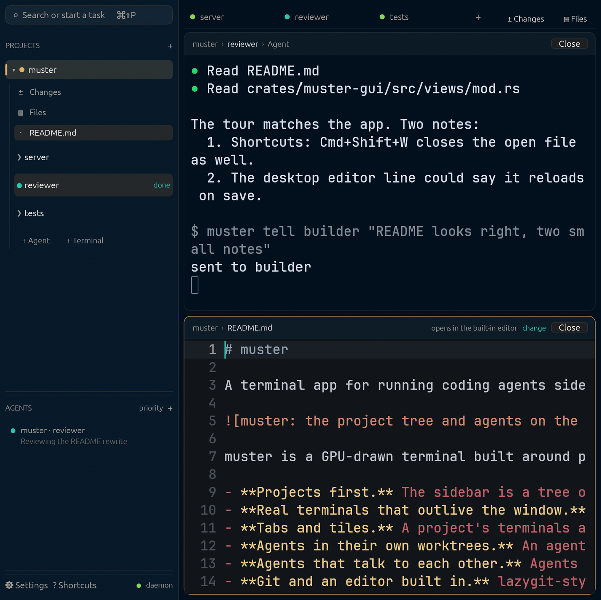
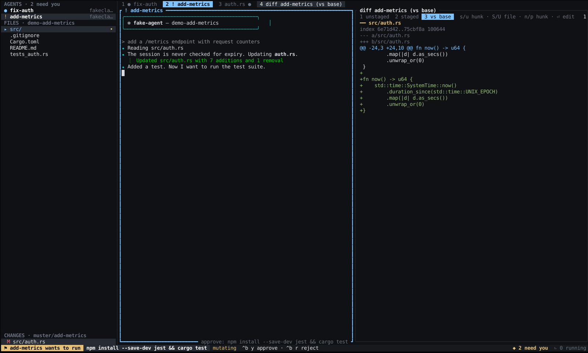

# muster

A terminal app for running coding agents side by side.



muster is a GPU-drawn terminal built around projects and the agents working in them. Your terminals, Claude Code / Codex / OpenCode sessions, each project's git changes and files, and an editor all live in one window. You can see at a glance which agent is working, which one is waiting on you and what each one is doing, and step in without switching apps.

- **Projects first.** The sidebar is a tree of your projects. Each one holds its Changes, its Files and its terminals; agents across every project are listed below by what needs you.
- **Real terminals that outlive the window.** Every tab is a real PTY owned by a background daemon. Close muster and your terminals and agents keep running; open it again and everything is where you left it.
- **Tabs and tiles.** A project's terminals are tabs. Drag one onto another to tile them, resize the tiles, swap them, maximize one.
- **Agents in their own worktrees.** An agent you start from muster gets its own git worktree and branch (`muster/<name>`), an undo timeline of snapshots, and an approval bar for the commands it wants to run.
- **Agents that talk to each other.** Agents can list each other, send messages and wait on each other's work through the `muster` command.
- **Git and an editor built in.** lazygit-style Changes with hunk staging, commit and merge; a file tree that opens files in the built-in editor, nvim/helix inside the card, or VS Code, Zed and friends.

## Install

You need Rust 1.80+ and `git`. macOS and Linux are supported. Windows isn't yet, since the daemon uses Unix sockets.

```sh
cargo install --path crates/muster       # the daemon, CLI and terminal UI
cargo install --path crates/muster-gui   # the app
muster-gui ~/code/my-app                 # or run `muster-gui` inside a repo
```

The daemon starts on its own the first time anything needs it.

**macOS app:** `scripts/macos-app.sh` builds `~/Applications/Muster.app` so muster opens from Spotlight or the Dock. Launched that way it loads your login shell's environment (`PATH`, API keys), so `claude` and `codex` are found.

**Renderer:** muster draws with wgpu (Metal on macOS) by default. `cargo install --path crates/muster-gui --no-default-features --features glow` builds an OpenGL version instead: 10.5 MB against 14.5 MB, with the same memory use and no difference at idle.

## A quick tour

1. **Open a project.** Run `muster-gui` in a repo, or press **+** beside PROJECTS and pick a folder. It opens with a terminal; name its tab and press Enter (or just Enter to keep `term-1`).
2. **Start an agent.** **+ Agent** under the project, or ⌘⇧N. Give it a task and a name; the name is also its branch. Or type the task into the command bar (⌘⇧P) and press Enter.
3. **Watch it.** It appears under AGENTS with its status and what it's working on. When it needs you (an approval, a question, a finished turn), it moves to the top, the project shows "1 waiting", and the dock bounces if muster is in the background.
4. **Work beside it.** **+** in the tab strip opens another terminal. Drag its tab onto the agent's tab to tile them. Open **± Changes** to review the diff, stage hunks and commit, or **▤ Files** to open a file.
5. **Approve or undo.** Commands that change things wait for **Approve / Reject**. Every agent has an undo history (⌘⇧U); revert to any step, and undo the revert if you change your mind.

## The window

```
┌ ⌕ Search or start a task  ⌘⇧P ┐┌ ● server   ● reviewer  ● tests   +     ± Changes 6  ▤ Files ┐
│ PROJECTS                    + ││┌ muster › reviewer › Agent ──┐┌ muster › README.md ─────────┐│
│ ▾ ● muster                    │││                             ││                             ││
│     ± Changes        6 files  │││   the agent's terminal      ││   the file, in your editor  ││
│     ▤ Files                   │││                             ││                             ││
│     · README.md               │││                             ││                             ││
│     ❯ server                  │││                             ││                             ││
│     ○ reviewer       working  │││                             ││                             ││
│     ❯ tests                   ││└─────────────────────────────┘└─────────────────────────────┘│
│     + Agent  + Terminal       ││                                                             │
│ ▸ ● augur          1 waiting  ││                                                             │
│ AGENTS             priority + ││                                                             │
│ ● muster · reviewer           ││                                                             │
│   Reviewing the login fix     ││                                                             │
│ ⚙ Settings  ? Shortcuts  ● daemon                                                            │
└───────────────────────────────┘└─────────────────────────────────────────────────────────────┘
```

### Projects

Every project (a git repo, or a folder that isn't one) is a branch of the tree: its **Changes**, its **Files**, files you've opened, then its terminals in the order you opened them. A terminal running an agent stays in its place and shows the agent's status. **+ Agent** and **+ Terminal** sit at the end of each project. Click a project to switch to it (⌘1–9, or ⌘⇧J / ⌘⇧K to step), and use ▸ to fold one away; the tree doesn't fold or reorder itself.

Terminals follow `cd`. A terminal that moves into another repo moves to that project.

### Agents

AGENTS lists the agents in every project, one row each, as herdr does: a status dot, `project · name`, and the title the agent gives its terminal (Claude Code's summary of the session), or what it's waiting on. Sort by **priority** (approve, blocked, done, working, idle) or **recent**. Clicking an agent switches to its project and shows it. Right-click for its Changes, merge, kill or remove.

Any terminal running claude, codex, opencode, gemini, aider, goose, amp and other agent CLIs counts as an agent, whether muster started it or you typed it. When one is blocked on a numbered prompt, its choices show as buttons under it in the tree, so you can answer without opening it.

### Tabs and cards

The open project's terminals and agents are tabs along the top of the stage (or the bottom: Settings → Tabs and cards). Click a tab to show it in the focused card; double-click to rename; middle-click or × to close a terminal; ⌘⇧[ / ⌘⇧] step through them.

Whatever is on screen sits in a **card**. ⌘⇧D splits, and you can tile as many cards as you like:

- drag a tab onto another tab, or onto a card, to tile it beside that one;
- drag a card's title bar onto another card to swap them;
- drag the gap between cards to resize them, double-click it to even them out;
- ⌥H / J / K / L move between cards, ⌥⇧H / J / K / L swap, ⌥Z maximizes, ⌥W closes (the modifier can be ⌃⌥ or off in Settings);
- right-click a title bar to maximize, swap, broadcast or close.

**Broadcast** (⌘⇧B) sends your typing to every terminal card at once.

### Changes

lazygit's layout and keys for the project's repo: Status, Changed files, Branches, Commits and (for agents) the undo history, with the diff beside them. Stage and unstage whole files or single hunks, discard, commit, check out a branch, and double-click a diff line to open the file there. An agent with its own worktree has its own Changes, with **vs base** (everything the agent did on its branch) and **merge** to bring its branch back into your checkout.

### Files and editors

The project's file tree. Clicking a file opens it in the editor you choose in Settings:

- the **built-in editor** (syntax highlighting, undo, find, go to line), which reloads live when an agent changes the file;
- a **terminal editor** (nvim, vim, helix, micro, nano) running inside the card;
- a **desktop editor** (VS Code, Cursor, Zed, Sublime, JetBrains IDEs) opened at the line, while the built-in editor follows along and reloads as you save;
- or `$VISUAL` / `$EDITOR`.

⌘-click a path in a terminal (`src/app.rs:42` too) to open it the same way.

### Approvals and undo

muster hooks into Claude Code for that session only, through `--settings`. Read-only commands run without asking, commands that change things wait in an approval bar (**Approve** ⌘⇧Y, **Reject** ⌘⇧R), and destructive ones are refused. The rules are yours to change in the config.

Every agent also has a shadow-git timeline: a snapshot before each tool call, after file changes and at the end of each turn. Diff any step, revert to it, and undo a revert.

### Notifications

Agents' own notifications (OSC 9 / 777 / 99; Claude Code sends them with `preferredNotifChannel` set to `iterm2` or `ghostty`) show as toasts. While muster is in the background, an agent that needs you or finishes also posts a system notification (Settings → New agents turns that off).

## Agents working together

Agents coordinate through the `muster` command, which every muster terminal has on its `PATH`. Each terminal also knows its own id as `$MUSTER_TASK_ID`.

```sh
muster agents                          # every agent and terminal: status, folder, what it's doing
muster tell reviewer "check the login fix, then tell me"
muster wait reviewer                   # block until its turn ends
muster read reviewer -n 60             # the end of its screen
```

`muster tell` types the message into the other agent's prompt and submits it, marked with who it's from and how to answer:

```
[message from agent builder; reply with: muster tell builder "..."] check the login fix, then tell me
```

Claude Code agents started by muster are told all of this in their system prompt. For an agent you started yourself in a terminal, ask it to run `muster guide`. Every message shows as a toast in the app and is kept in the audit log.

## Shortcuts

App commands use **⌘⇧** on macOS and **Ctrl+Shift** on Linux, as in keel, so plain ⌘ and every Ctrl key stay with the terminal (Ctrl+C still interrupts).

| | macOS | Linux |
|---|---|---|
| Command bar: open a file, jump to an agent, start a task | ⌘⇧P or ⌘P | Ctrl+Shift+P |
| New agent / new terminal | ⌘⇧N / ⌘⇧T | Ctrl+Shift+N / T |
| Next agent that needs you | ⌘⇧A | Ctrl+Shift+A |
| Approve / reject the pending command | ⌘⇧Y / ⌘⇧R | Ctrl+Shift+Y / R |
| Changes / Files / undo history (again to go back) | ⌘⇧G / ⌘⇧O / ⌘⇧U | Ctrl+Shift+G / O / U |
| Split / close the focused card or open file | ⌘⇧D / ⌘⇧W | Ctrl+Shift+D / W |
| Next / previous tab | ⌘⇧] / ⌘⇧[, Ctrl+Tab | Ctrl+Tab / Ctrl+Shift+Tab |
| Switch project / previous, next | ⌘1–9 / ⌘⇧J, ⌘⇧K | Ctrl+1–9 / Ctrl+Shift+J, K |
| Broadcast typing to every terminal card | ⌘⇧B | Ctrl+Shift+B |
| Hide or show the sidebar | ⌘⇧E | Ctrl+Shift+E |
| Font bigger / smaller / reset | ⌘= / ⌘- / ⌘0 | Ctrl+= / - / 0 |
| Settings / all shortcuts | ⌘, / ⌘⇧/ | Ctrl+, / Ctrl+Shift+/ |

**Cards:** ⌥H / J / K / L focus, ⌥⇧H / J / K / L swap, ⌥Return new terminal in its own card, ⌥W close, ⌥Z maximize.

**Terminal:** ⌘C / ⌘V copy and paste (Ctrl+Shift+C / V on Linux) · ⌘F find in the scrollback · ⌘↑ / ⌘↓ previous / next command · ⌘K clear · ⌘-click a link or path · double-click a word, triple-click a line · Shift+PageUp / PageDown scroll back · mouse reporting for vim, htop and tmux (hold Shift to select instead) · right-click for copy, paste, copy the last command's output and snippets.

**Changes:** `1`–`5` or `h` / `l` pick a panel · `j` / `k` move, the diff follows · Enter into the diff, Esc back · space stage or unstage, `a` everything, `d` discard, `e` edit · `c` commit · in the diff: `n` / `p` next or previous hunk, `s` / `u` stage or unstage the hunk · `b` diff against the agent's base · `m` merge its branch · undo history: `r` revert to here, `n` checkpoint.

**Built-in editor:** ⌘S save · ⌘Z / ⌘⇧Z undo, redo · ⌘F find, ⌘G next · ⌘L go to line · ⌘K delete line · ⌘R reload from disk.

## Command line

The daemon owns every terminal, so the app, the terminal UI (`muster` on its own) and the CLI all drive the same sessions:

```sh
muster ls                                # tasks and their status
muster inbox                             # what's waiting on you
muster new fix-auth -p "fix the login redirect loop"   # an agent on its own branch
muster attach fix-auth                   # one session full screen in any terminal (Ctrl-] detaches)
muster approve 3 | deny 3                # answer a pending approval
muster snaps fix-auth                    # its undo history
muster diff fix-auth '#5^' '#5'          # what one step changed
muster revert fix-auth '#4'              # roll back to a step
muster run tag:web -- 'journalctl -u nginx -n 50'   # policy-checked SSH across hosts
muster ask "why is prod-3 returning 502s?"          # an LLM investigation over SSH, saved as a runbook
muster stop                              # stop the daemon and everything it runs
```



## Configure

**`~/.muster/config.toml`** is shared by the daemon, CLI and both UIs. `muster init` writes it with every option documented:

```toml
[agents.aider]
command = "aider"
prompt_mode = "type"        # "arg": prompt as the last argument · "type": typed in · "none"
attention_on_idle = true

[policy]                    # agents' shell commands and fleet commands
read_only = "allow"
mutating = "ask"
destructive = "deny"
rules = [{ pattern = "cargo test*", decision = "allow" }]

[tui]
theme = "base16-ocean.dark" # the editor's syntax theme
```

**Settings** (⌘, or ⚙ at the foot of the sidebar) holds the app's look and behaviour, saved to `~/.muster/gui.json`:

- font (any installed monospace font or a font file), weight, bold weight, size and line height; pick a Nerd Font if your prompt uses icons;
- one of 26 colour themes, cursor style, transparency and blur;
- your editor, the default agent and whether new agents get a worktree;
- tabs at the top or bottom, and the card keys' modifier;
- snippets: commands you run often, from the command bar or a terminal's right-click menu.

Without a chosen font muster uses SF Mono or Menlo (JetBrains Mono or DejaVu on Linux) with symbol, CJK and colour emoji fallbacks, or `MUSTER_FONT=/path/to/font.ttf`.

The layout (projects, tabs, cards and open files) is saved to `~/.muster/layout.json` and put back on the next launch.

## How it works

```
muster-gui (egui + wgpu)    muster (terminal UI)    muster <cmd> (CLI)    Claude Code hooks
        └──────────────────────────┬─────────────────────┬────────────────────┘
                       ~/.muster/muster.sock (msgpack)
                                   │
            muster daemon: PTYs and vt100 screens, worktrees, shadow-git snapshots,
                     approvals, command policy, agent messages, audit log
```

The daemon owns the terminals; the app keeps a local copy of each screen, fed by the daemon's output, and draws it on the GPU. That's why closing the window never stops an agent.

```
crates/
  muster-core/   protocol, config, command policy, agent detection, git, editor, file tree, client
  muster/        the `muster` binary: daemon, CLI and terminal UI
  muster-gui/    the app: state and actions (app.rs), the UI (views/), the terminal view, tiling, settings
scripts/macos-app.sh
```

`cargo test --workspace` runs 45 tests: the command policy, config merging, snapshots (dedupe, diff, revert, undoing a revert), git (hunks, commit, merge), the editor, the file tree, terminal rendering and key encoding, colour emoji, card layout, agent messages and secret redaction.

## Known limitations

- Terminals survive the app closing, not the daemon stopping (`muster stop`). Worktrees and snapshots always survive.
- The approval bar works with Claude Code. Other agents' own prompts show as *waiting* and are answered in their tab.
- The built-in editor has no multi-cursor and no text selection yet; copy and cut work on whole lines.
- Card sizes reset when the app restarts.

## License

MIT
